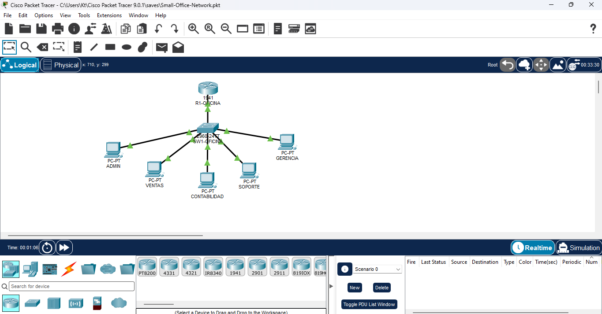
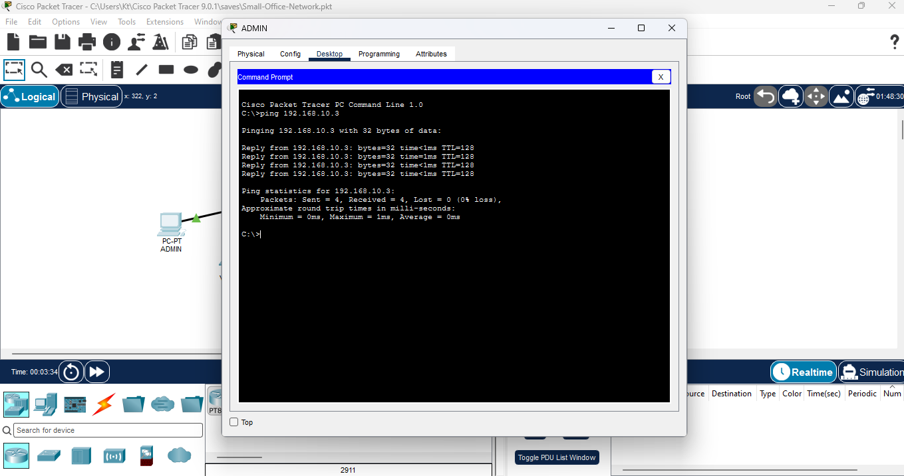

# 🌐 Small Office Network

## Descripción

Este proyecto consiste en el diseño y configuración de una red LAN básica para una pequeña oficina utilizando Cisco Packet Tracer.

El objetivo es practicar conceptos fundamentales de redes, incluyendo dispositivos de red, direccionamiento IPv4, configuración básica de un router y pruebas de conectividad.

## 🧩 Topología

La red está formada por:

- 1 router Cisco 1941
- 1 switch Cisco 2960
- 5 computadoras
- Conexiones Ethernet

### Distribución

```text
                    R1-OFICINA
                  192.168.10.1
                       │
                       │
                  SW1-OFICINA
                       │
       ┌───────────────┼───────────────┐
       │       │       │       │       │
      PC1     PC2     PC3     PC4     PC5
     Admin   Ventas   Cont.  Soporte  Gerencia
```

## 🌐 Direccionamiento IP

| Dispositivo | IP | Máscara | Gateway |
|---|---|---|---|
| Router | 192.168.10.1 | 255.255.255.0 | — |
| PC1 | 192.168.10.2 | 255.255.255.0 | 192.168.10.1 |
| PC2 | 192.168.10.3 | 255.255.255.0 | 192.168.10.1 |
| PC3 | 192.168.10.4 | 255.255.255.0 | 192.168.10.1 |
| PC4 | 192.168.10.5 | 255.255.255.0 | 192.168.10.1 |
| PC5 | 192.168.10.6 | 255.255.255.0 | 192.168.10.1 |

## ⚙️ Configuración

La interfaz del router conectada a la red LAN fue configurada con:

```text
IP: 192.168.10.1
Máscara: 255.255.255.0
```

Las computadoras fueron configuradas con direcciones IP estáticas dentro de la misma red.

## 🧪 Pruebas

Se realizaron pruebas de conectividad utilizando el comando `ping`.

Ejemplo:

```text
ping 192.168.10.3
```

Las pruebas fueron exitosas, confirmando la comunicación entre los dispositivos de la red.

## 📸 Capturas

### Topología



### Configuración IP


### Prueba de conectividad



## 📚 Conceptos practicados

- Redes LAN
- Direccionamiento IPv4
- Máscaras de subred
- Gateway predeterminado
- Routers
- Switches
- Conexiones Ethernet
- Configuración básica de Cisco IOS
- Pruebas de conectividad con `ping`

## 🛠️ Herramienta

**Cisco Packet Tracer**

## 🎯 Aprendizaje

Este proyecto me permitió practicar de forma virtual la creación de una red básica y comprender cómo los dispositivos se conectan y se comunican mediante direcciones IP.

Es mi primer proyecto práctico relacionado directamente con mi formación en Redes Informáticas.
